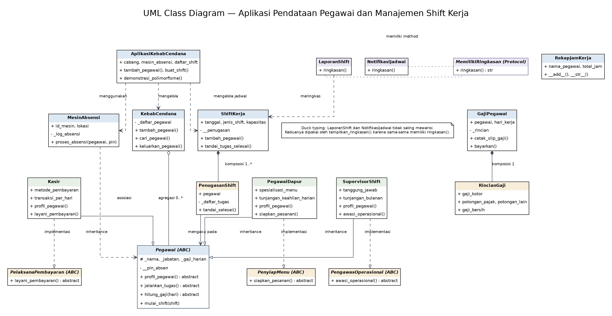

# Posttest 3 PBO - Aplikasi Pendataan Pegawai dan Manajemen Shift Kerja

**Nama:** Antung Hissyam  
**NIM:** 2509106092  
**Kelas:** C1 2025  
**Program Studi:** Informatika

## 1. Deskripsi

Posttest 3 ini melanjutkan program **Manajemen Pegawai Kebab Cendana** pada Posttest 1 dan Posttest 2. Konsep sebelumnya tetap dipakai data pegawai, PIN absensi, subclass `Kasir` dan `PegawaiDapur`, cabang, shift, mesin absensi, serta perhitungan gaji kemudian dikembangkan dengan abstraksi menggunakan `ABC`, polimorfisme, duck typing, operator overloading, dan pemisahan tanggung jawab class.

Program dapat dijalankan sebagai aplikasi terminal interaktif. Pengguna dapat melihat dan menambahkan pegawai, membuat jadwal shift, menugaskan pegawai, memproses absensi, menghitung gaji, serta melihat hasil demonstrasi konsep PBO. Data disimpan selama program berjalan dan belum menggunakan database.

## 2. Menjalankan Program

Program memakai Python 3.10 atau lebih baru dan tidak memerlukan package tambahan. Kode dipisah ke beberapa modul di folder `kebab_cendana/`; file `kebab_pt3.py` tetap menjadi pintu masuk agar cara menjalankan program tetap sederhana.

Masuk ke folder `posttest/posttest3`, lalu jalankan aplikasi terminal:

```bash
python kebab_pt3.py
```

Pada Windows, perintah berikut juga dapat digunakan:

```powershell
py kebab_pt3.py
```

Untuk menjalankan demonstrasi seluruh konsep tanpa menu interaktif:

```bash
python kebab_pt3.py --demo
```

Untuk menjalankan pengujian otomatis:

```bash
python -m unittest -v test_posttest3.py
```

Data awal memuat Antung Hissyam (Kasir), Dita (Pegawai Dapur), dan Rafi (Supervisor Shift), beserta contoh jadwal Pagi dan Sore. Data tersebut hanya data contoh dan dapat ditambah lewat menu program.

## 3. Struktur File

```text
posttest3/
├── kebab_pt3.py
├── test_posttest3.py
├── README.md
├── contoh-output.txt
├── hasil-pengujian.txt
├── diagram/
│   ├── class-diagram.png
│   └── class-diagram.dot
└── kebab_cendana/
    ├── __init__.py
    ├── pegawai.py
    ├── peran_pegawai.py
    ├── cabang.py
    ├── absensi.py
    ├── shift.py
    ├── penggajian.py
    ├── polimorfisme.py
    ├── aplikasi.py
    ├── demonstrasi.py
    └── terminal.py
```

Setiap modul punya tugas tertentu: abstract class `Pegawai` dan kontrak kemampuan berada di `pegawai.py`; subclass `Kasir`, `PegawaiDapur`, dan `SupervisorShift` berada di `peran_pegawai.py`. Penjadwalan ada di `shift.py`, perhitungan gaji di `penggajian.py`, sedangkan menu terminal dipisahkan ke `terminal.py`. Dengan pemisahan ini, file launcher tidak lagi memuat ratusan baris logika dalam satu tempat.

## 4. Fitur Program

1. Menampilkan daftar pegawai beserta ID, jabatan, data khusus, dan status aktif.
2. Menambahkan pegawai berjenis Kasir, Pegawai Dapur, atau Supervisor Shift.
3. Membuat jadwal Pagi, Sore, atau Malam dengan tanggal dan kapasitas.
4. Menugaskan pegawai ke shift dan mencatat beberapa tugas untuk tiap pegawai.
5. Mencegah penugasan ganda pada shift yang sama, penugasan pegawai nonaktif, serta penugasan ketika kapasitas penuh.
6. Memproses absensi melalui mesin dengan validasi PIN dan menyimpan log hasil absensi.
7. Menghitung slip gaji berisi gaji kotor, pajak, potongan lain, dan gaji bersih.
8. Mencatat pembayaran gaji agar pengeluaran tidak tercatat dua kali untuk slip yang sama.
9. Menampilkan demonstrasi abstraksi, polimorfisme, duck typing, operator overloading, asosiasi, dan komposisi.

## 5. Struktur Class

| Class | Tanggung jawab |
|---|---|
| `Pegawai` | Abstract base class yang menyimpan data umum pegawai, enkapsulasi PIN, validasi, dan perilaku bersama. |
| `Kasir` | Data khusus metode pembayaran dan transaksi; menghitung gaji kasir serta melayani pembayaran. |
| `PegawaiDapur` | Data spesialisasi menu dan tunjangan keahlian; menghitung gaji dan menyiapkan pesanan. |
| `SupervisorShift` | Data tanggung jawab supervisor dan tunjangan bulanan; menjalankan fungsi pengawasan. |
| `PelaksanaPembayaran` | Kontrak khusus untuk class yang dapat memproses pembayaran. |
| `PenyiapMenu` | Kontrak khusus untuk class yang dapat menyiapkan pesanan. |
| `PengawasOperasional` | Kontrak khusus untuk class yang mengawasi kegiatan operasional. |
| `KebabCendana` | Mengelola daftar pegawai sebuah cabang. Pegawai dibuat di luar class cabang. |
| `MesinAbsensi` | Memvalidasi PIN pegawai dan menyimpan log absensi tanpa memiliki siklus hidup pegawai. |
| `ShiftKerja` | Mengatur tanggal, jenis shift, kapasitas, dan daftar penugasan. |
| `PenugasanShift` | Komponen internal sebuah shift yang menyimpan pegawai, daftar tugas, dan status penyelesaian. |
| `GajiPegawai` | Menyusun perhitungan slip gaji dan mencatat pembayaran. |
| `RincianGaji` | Komponen yang menghitung pajak, potongan, dan gaji bersih. |
| `LaporanShift` | Menghasilkan ringkasan jumlah shift dan penugasan. |
| `NotifikasiJadwal` | Menghasilkan ringkasan notifikasi untuk penerima. |
| `MemilikiRingkasan` | `Protocol` struktural untuk pengetikan fungsi; class laporan dan notifikasi tidak perlu mewarisinya. |
| `RekapJamKerja` | Menyimpan total jam kerja dan mendukung operator `+`. |
| `AplikasiKebabCendana` | Menyediakan data awal dan menghubungkan class-class untuk kebutuhan aplikasi terminal. |

## 6. Abstraksi dan Abstract Base Class

`Pegawai` mewarisi `ABC` dari modul `abc`. Class ini memiliki tiga abstract method:

```python
@abstractmethod
def profil_pegawai(self) -> str:
    ...

@abstractmethod
def jalankan_tugas(self) -> str:
    ...

@abstractmethod
def hitung_gaji(self, hari_kerja: int) -> int:
    ...
```

`Kasir`, `PegawaiDapur`, dan `SupervisorShift` mengimplementasikan ketiga method tersebut. Selain menjadi kontrak bagi subclass, `Pegawai` memiliki method konkret `mulai_shift()` dan `__str__()` yang dapat dipakai oleh semua subclass.

Program mencoba membuat object `Pegawai` secara langsung saat demonstrasi. Python mengangkat `TypeError` karena abstract method-nya belum diimplementasikan. Ini membuktikan bahwa `Pegawai` adalah abstract class, bukan class konkret yang dapat diinstansiasi langsung.

## 7. Inheritance, `super()`, dan Enkapsulasi

Pewarisan utama yang digunakan:

```text
Pegawai
├── Kasir
├── PegawaiDapur
└── SupervisorShift
```

Setiap subclass memanggil `super().__init__(...)` agar atribut dasar seperti ID, nama, jabatan, PIN, dan gaji harian diinisialisasi pada parent class.

Atribut khusus subclass:

- `Kasir`: `metode_pembayaran`, `transaksi_per_hari`, dan `bonus_per_transaksi`.
- `PegawaiDapur`: `spesialisasi_menu` dan `tunjangan_keahlian_harian`.
- `SupervisorShift`: `tanggung_jawab` dan `tunjangan_bulanan`.

Enkapsulasi yang ditunjukkan dalam program:

- **Protected:** `_nama`, `_jabatan`, `_gaji_harian`. Subclass dapat menggunakan data tersebut sebagai bagian dari perilakunya.
- **Private:** `__pin_absen` pada `Pegawai`; PIN dibaca dan diubah melalui property `pin_absen`, dengan validasi sebelum nilai disimpan.
- Property `nama` dan `gaji_harian` juga memvalidasi perubahan data.

## 8. Polimorfisme dan Method Overriding

Ketiga subclass meng-override method yang sama, terutama `profil_pegawai()`, `jalankan_tugas()`, dan `hitung_gaji()`. Hasilnya berbeda berdasarkan perilaku masing-masing class, tanpa memeriksa tipe object satu per satu.

Contoh loop polimorfik dari program:

```python
for pegawai in self.cabang.daftar_pegawai:
    baris.append(pegawai.profil_pegawai())
    baris.append(pegawai.jalankan_tugas())
    baris.append(f"Gaji kotor 20 hari: IDR {pegawai.hitung_gaji(20):,.0f}")
```

Loop yang sama dapat memproses object `Kasir`, `PegawaiDapur`, dan `SupervisorShift`. Penambahan subclass pegawai baru yang memenuhi kontrak `Pegawai` tidak mengharuskan loop tersebut diubah. Pilihan `if/elif` pada menu terminal hanya membaca pilihan menu pengguna, bukan memilih perilaku berdasarkan jenis object.

## 9. Duck Typing

`LaporanShift` dan `NotifikasiJadwal` tidak memiliki hubungan inheritance satu sama lain. Keduanya memiliki method bernama `ringkasan()` dengan hasil yang sesuai tanggung jawabnya.

```python
def tampilkan_ringkasan(objek: MemilikiRingkasan) -> str:
    return objek.ringkasan()
```

Fungsi tersebut cukup memanggil `ringkasan()` dan tidak menggunakan `isinstance`, `type()`, atau rangkaian `if/elif` untuk membedakan kedua class. `MemilikiRingkasan` adalah `Protocol` untuk membantu pengetikan statis; `LaporanShift` dan `NotifikasiJadwal` tidak perlu mewarisi protocol itu.

## 10. Operator Overloading

Class `RekapJamKerja` mengimplementasikan:

- `__add__()` agar dua object rekap dapat dijumlahkan dengan operator `+`.
- `__str__()` agar object mudah ditampilkan sebagai teks.

Contoh:

```python
rekap_antung = RekapJamKerja("Antung Hissyam", 8)
rekap_dita = RekapJamKerja("Dita", 7)
print(rekap_antung + rekap_dita)
```

Hasil:

```text
Antung Hissyam + Dita: 15 jam
```

Operasi menghasilkan object baru, tidak mengubah total jam pada kedua object asal.

## 11. Relasi UML



Sumber diagram tersedia pada `diagram/class-diagram.dot`.

### A. Inheritance

`Kasir`, `PegawaiDapur`, dan `SupervisorShift` mewarisi `Pegawai`. Masing-masing juga mengimplementasikan kontrak peran spesifiknya, yaitu `PelaksanaPembayaran`, `PenyiapMenu`, atau `PengawasOperasional`.

### B. Asosiasi: `MesinAbsensi` dengan `Pegawai`

Object pegawai diberikan ke method `MesinAbsensi.proses_absensi(pegawai, pin)`. Mesin menggunakan data pegawai untuk memvalidasi PIN, lalu menyimpan detail hasil absensi. Mesin tidak membuat atau mengelola siklus hidup object pegawai.

### C. Agregasi: `KebabCendana` dengan `Pegawai`

Pegawai dibuat di luar class cabang, lalu ditambahkan melalui `tambah_pegawai()`. Saat pegawai dikeluarkan dari cabang, object pegawai yang sama tetap dapat dipakai oleh kode pemanggil. Daftar cabang hanya menjadi wadah pengelolaan pegawai aktif.

### D. Komposisi: `ShiftKerja` dengan `PenugasanShift`

Object `PenugasanShift` dibuat di dalam `ShiftKerja.tambah_pegawai()`, disimpan pada atribut private `__penugasan`, dan tidak diberikan keluar sebagai object komponen mentah. Properti yang ditampilkan ke luar hanya berupa snapshot data. Saat penugasan dihapus dari shift, komponen tersebut dilepas dari pemiliknya.

### E. Komposisi: `GajiPegawai` dengan `RincianGaji`

Object `RincianGaji` dibuat oleh constructor `GajiPegawai` untuk menyimpan gaji kotor, pajak, potongan tambahan, dan gaji bersih. `GajiPegawai` memakai rincian itu untuk mencetak slip dan memproses pembayaran.

## 12. Penerapan SOLID

| Prinsip | Penerapan dalam program |
|---|---|
| **S — Single Responsibility** | `MesinAbsensi` fokus pada absensi, `ShiftKerja` pada jadwal dan penugasan, `GajiPegawai` pada perhitungan/pembayaran, sedangkan `KebabCendana` pada daftar pegawai cabang. |
| **O — Open/Closed** | `AplikasiKebabCendana.demonstrasi_polimorfisme()` bekerja melalui kontrak `Pegawai`. Subclass baru dapat ditambahkan dengan mengimplementasikan method abstract tanpa mengubah loop polimorfik. |
| **L — Liskov Substitution** | Semua subclass dapat digunakan pada operasi yang meminta `Pegawai`, termasuk daftar cabang, jadwal shift, absensi, dan perhitungan gaji, tanpa menghilangkan kontrak dasarnya. |
| **I — Interface Segregation** | Kemampuan spesifik dipisah ke kontrak `PelaksanaPembayaran`, `PenyiapMenu`, dan `PengawasOperasional`. Tidak setiap pegawai harus menyediakan semua kemampuan khusus tersebut. |
| **D — Dependency Inversion** | `KebabCendana`, `MesinAbsensi`, `ShiftKerja`, dan `GajiPegawai` bekerja dengan kontrak `Pegawai`, bukan mengandalkan satu subclass tertentu untuk operasi umum. |

## 13. Pengujian Otomatis

File `test_posttest3.py` berisi **21 pengujian** menggunakan `unittest` bawaan Python. Pengujian mencakup:

- Abstract class tidak dapat diinstansiasi.
- Subclass menerapkan abstract method dan method override.
- Method konkret bersama, validasi PIN, protected/private attribute, dan atribut unik subclass.
- Perhitungan gaji, validasi hari kerja, pajak, dan pencatatan pembayaran satu kali.
- Agregasi cabang, asosiasi absensi, dan komposisi tugas shift.
- Validasi tanggal shift, duck typing, operator overloading, dan data awal aplikasi.

Menjalankan pengujian tidak membutuhkan database atau library eksternal. Hasil uji yang diperiksa saat penyusunan: **21 test lulus**.

## 14. Contoh Hasil Program

Jalankan `python kebab_pt3.py --demo` untuk menampilkan bukti singkat semua konsep yang diwajibkan. Output lengkap tersimpan di [`contoh-output.txt`](contoh-output.txt). Tampilan terminal menggunakan judul sederhana dan jarak antarbagian seperlunya, tanpa banner dekoratif. Nilai gaji adalah contoh simulasi untuk kebutuhan praktikum, bukan perhitungan payroll riil perusahaan.

## 15. Catatan

Program menggunakan data dalam memori. Data pegawai, jadwal, dan log absensi akan kembali ke data awal ketika aplikasi ditutup. Database dan autentikasi pengguna belum termasuk pada versi ini.
